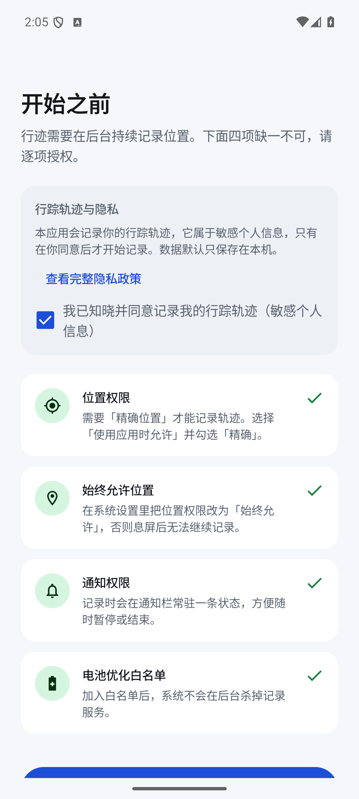
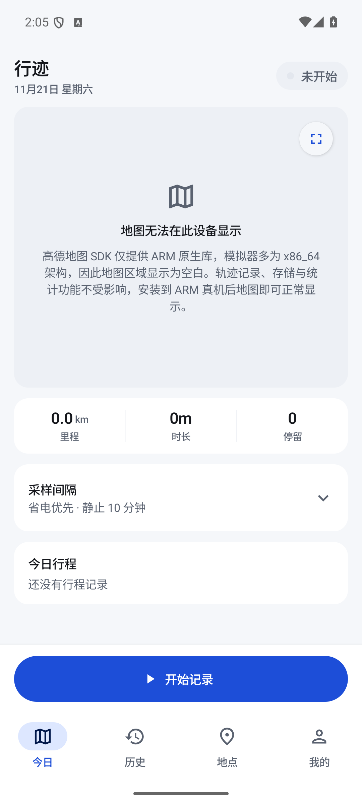
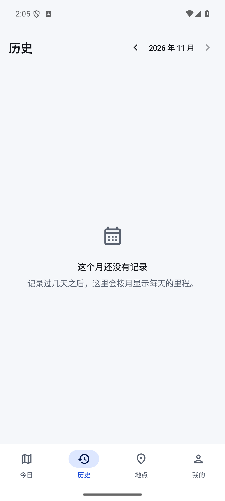
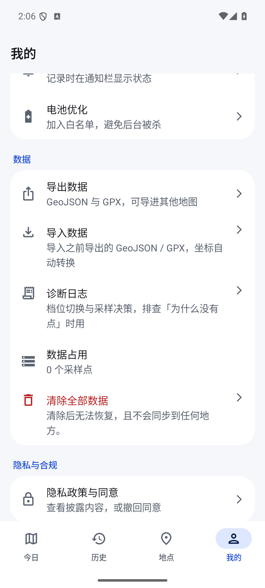
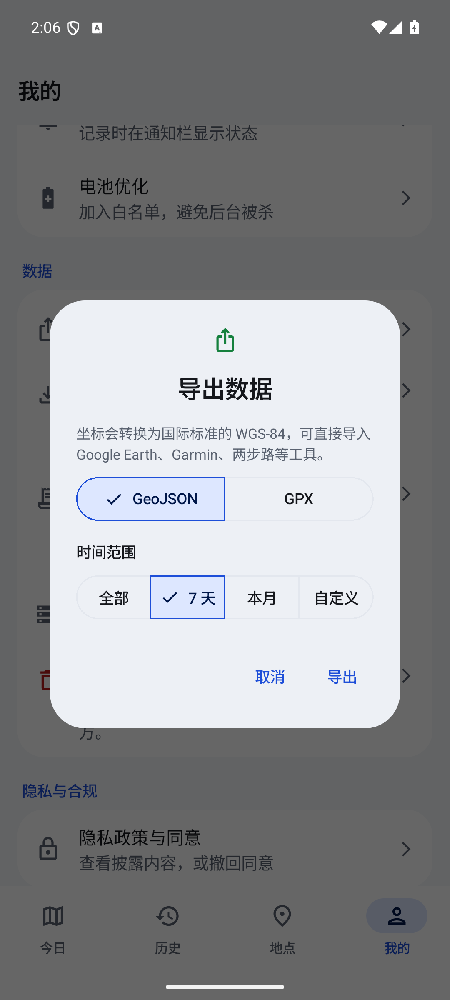
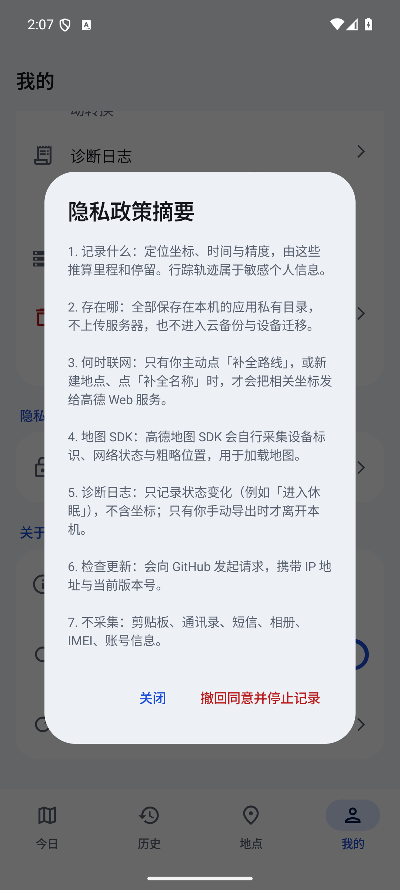

# 行迹 DayTrail

行迹是一款本地优先的个人轨迹记录应用。后台按省电策略采集位置，按日写入本地数据库，可回看每日路线、停留点与里程；连续多日的出行自动归并为行程。数据支持导出，亦可重新导入。

- 无账号体系，无自建服务器，轨迹数据仅存储于本机
- 除地图瓦片加载与用户主动触发的高德 Web 服务调用外，不进行其他联网
- 包名 `com.hmilyld.daytrail`，调试构建使用 `.debug` 后缀
- 最低系统版本 Android 12（API 31）

## 界面

截图取自 Android 15（API 35）模拟器。该环境为 x86_64 架构，而高德地图 SDK 仅提供 ARM 原生库，因此地图区域显示为占位说明。轨迹记录、存储与统计功能不受影响。

| 引导页 | 今日 | 历史 | 地点 |
|---|---|---|---|
|  |  |  |  |

| 设置 | 数据管理 | 导出 | 隐私与合规 |
|---|---|---|---|
|  |  |  |  |

## 功能

| 模块 | 说明 |
|---|---|
| 记录 | 前台服务按平均速度在 15 秒至 1 小时之间调整采样间隔；长时间静止进入休眠，由显著运动传感器唤醒 |
| 今日 | 地图、当日里程与时长、采样档位、最近三条行程；支持全屏查看完整轨迹 |
| 历史 | 按月日历与每日列表，可进入单日详情 |
| 单日详情 | 地图与时间轴分区展示（宽屏为左右分栏），数据缺失区间显式标注，可按需调用轨迹纠偏，也可手动拖动顶点微调画出来的线（只影响显示） |
| 行程 | 连续多日的出行自动归并 |
| 地点 | 停留超过 8 分钟自动聚类为地点，支持重命名、合并、删除与名称补全 |
| 数据 | 导出 GeoJSON 或 GPX（全部、最近 7 天、本月、自定义范围），导入同格式文件 |
| 诊断 | 记录状态变化日志（档位切换、运动与网络事件、定位探针结果），不含坐标，可导出 |
| 更新 | 从 GitHub Releases 检查新版本，校验 SHA-256 与签名后交由系统安装 |

## 开发环境

- JDK 17 及以上，推荐 21
- Android SDK：`compileSdk 37` 及对应 build-tools
- Android Studio 首次打开工程时会生成 `local.properties`，其中包含 `sdk.dir`

命令行构建如需手动指定，可设置环境变量：

```powershell
$env:JAVA_HOME = '<PATH_TO_JDK>'
$env:ANDROID_HOME = '<PATH_TO_ANDROID_SDK>'
```

`scripts/verify.ps1` 在环境变量缺失时会自动探测 JDK 与 SDK。

## 配置高德 Key

仓库不包含任何 Key。未配置时应用仍可构建运行，但地图显示占位说明，轨迹纠偏与地点名反查静默失败。

1. 访问 <https://console.amap.com/dev/key> 注册并完成实名认证。
2. 申请三个 Key：

   | Key | 服务平台 | 绑定信息 |
   |---|---|---|
   | Release | Android 平台 SDK | 包名 `com.hmilyld.daytrail` 与 release 签名 SHA1 |
   | Debug | Android 平台 SDK | 包名 `com.hmilyld.daytrail.debug` 与 debug 签名 SHA1 |
   | Web 服务 | Web 服务 | 用于轨迹纠偏与逆地理编码 |

3. 获取签名 SHA1：

   ```powershell
   keytool -list -v -keystore <PATH_TO_YOUR_KEYSTORE> -alias <YOUR_KEY_ALIAS>

   # 仓库内固定的调试密钥
   keytool -list -v -keystore app/keystore/debug.jks -alias androiddebugkey -storepass android
   ```

4. 复制 `local.properties.example` 为 `local.properties`，该文件不纳入版本控制：

   ```properties
   sdk.dir=<PATH_TO_ANDROID_SDK>
   AMAP_KEY_DEBUG=<YOUR_AMAP_ANDROID_KEY_DEBUG>
   AMAP_KEY_RELEASE=<YOUR_AMAP_ANDROID_KEY_RELEASE>
   AMAP_WEB_KEY=<YOUR_AMAP_WEB_SERVICE_KEY>
   ```

Windows 环境下 `sdk.dir` 的反斜杠与盘符冒号需转义，否则 lint 会报 `PropertyEscape` 错误。完整说明见 [`docs/amap-key-application.md`](docs/amap-key-application.md)。

## 构建与验证

```powershell
.\gradlew.bat :app:spotlessCheck
.\gradlew.bat :app:assembleDebug  :app:testDebugUnitTest  :app:lintDebug
.\gradlew.bat :app:assembleRelease :app:testReleaseUnitTest :app:lintRelease
```

或使用一键脚本：

```powershell
.\scripts\verify.ps1            # Debug 与 Release 全量校验
.\scripts\verify.ps1 -Quick     # 仅 Debug
.\scripts\verify.ps1 -Install   # 校验后安装到已连接设备
```

验收标准为 lint 无 error、单测全部通过、`spotlessCheck` 通过。格式化命令为 `.\gradlew.bat :app:spotlessApply`。

### 签名配置

Release 签名依赖仓库之外的 keystore 与 `keystore.properties`，两者均不纳入版本控制：

```properties
storeFile=<PATH_TO_YOUR_KEYSTORE>
storePassword=<YOUR_STORE_PASSWORD>
keyAlias=<YOUR_KEY_ALIAS>
keyPassword=<YOUR_KEY_PASSWORD>
```

模板见 `keystore.properties.example`。keystore 与口令须在仓库之外另行备份；丢失后将无法对已安装版本进行覆盖升级。

仓库内的 `app/keystore/debug.jks` 为公开的调试密钥（别名 `androiddebugkey`，口令 `android`），随仓库提交以保证各机器上的 debug SHA1 一致。该密钥仅用于调试构建，不可用于发布。

## 数据格式

导出文件采用 WGS-84 坐标系，应用内部统一存储 GCJ-02。导入时自动完成坐标转换。字段定义与校验规则见 [`docs/import-format.md`](docs/import-format.md)。

```json
{"type":"FeatureCollection","schema":2,"generator":"DayTrail 0.4.0",
 "features":[{"type":"Feature","properties":{
   "date":"2026-11-18","kind":"track","pointCount":2,
   "accuracies":[12.0,30.0],
   "times":["2026-11-18T08:00:00+08:00","2026-11-18T08:01:00+08:00"]},
  "geometry":{"type":"LineString","coordinates":[[121.4737,31.2304],[121.4747,31.2314]]}}]}
```

## 在线更新

更新检查读取 GitHub Releases 附带的静态清单，不消耗 GitHub API 的匿名配额：

```
https://github.com/<OWNER>/<REPO>/releases/latest/download/update.json
```

更新源在 `gradle.properties` 中配置，fork 后修改此值即可：

```properties
app.updateRepo=OWNER/REPO
```

留空表示不启用在线更新，设置页入口将提示未配置。清单字段、限流规则与校验流程见 [`docs/update.md`](docs/update.md)。

## 目录结构

```
app/src/main/java/com/hmilyld/daytrail/
├── core/          距离计算、坐标转换、日期与版本处理
├── data/
│   ├── db/        Room 实体与 DAO
│   ├── repo/      数据访问接口与本地实现
│   ├── export/    GeoJSON 与 GPX 导出
│   ├── import/    导入解析、校验、坐标转换与事务写入
│   ├── update/    版本清单、版本比较、下载与安装
│   ├── route/     轨迹纠偏客户端
│   └── geocode/   逆地理编码客户端
├── domain/        停留识别、抽稀、分段、行程归并
├── location/      定位源、采样节奏、前台服务、开机提醒
└── ui/            Compose 与 Navigation 3 界面层
```

架构说明与实现约束见 [`docs/DEVELOPMENT.md`](docs/DEVELOPMENT.md)。

## 参与贡献

参见 [`CONTRIBUTING.md`](CONTRIBUTING.md)。提交前请确认 `.\scripts\verify.ps1` 通过。

## 许可

源代码以 [MIT](LICENSE) 发布。第三方组件不受 MIT 许可覆盖，其中高德地图 SDK 为专有软件，清单见 [`THIRD_PARTY_NOTICES.md`](THIRD_PARTY_NOTICES.md)。

构建或分发 APK 时须遵守[高德开放平台服务条款](https://lbs.amap.com/home/terms)，不得移除或遮挡地图上的高德标识与版权信息。

## 免责声明

本项目按现状提供，不作任何形式的担保。轨迹数据属于行踪信息，在《个人信息保护法》中归为敏感个人信息。设备被他人使用、系统备份以及导出的文件均可能导致位置泄露。应用已关闭云备份，但无法约束导出后的传播。

本项目不面向 14 周岁以下儿童。隐私政策见 [`docs/privacy-policy.md`](docs/privacy-policy.md)。
